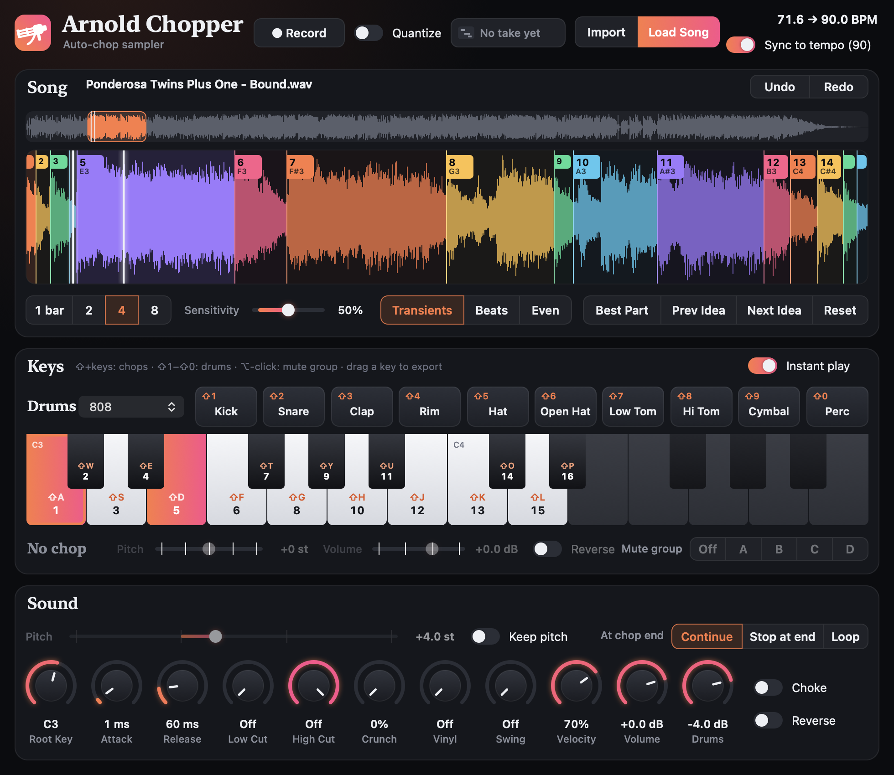
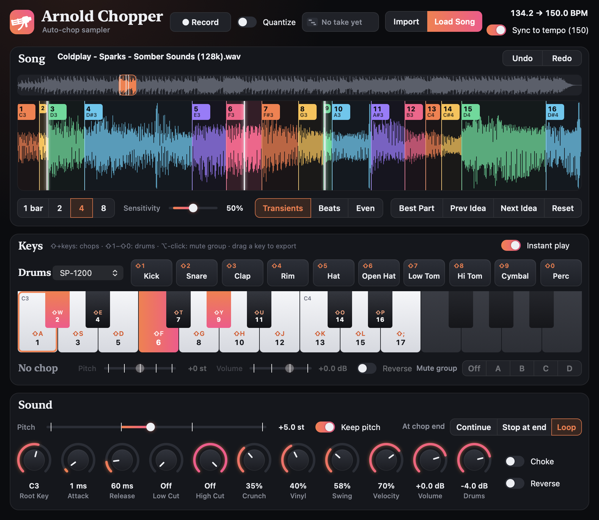

# Arnold Chopper

**An auto-chopping sampler for GarageBand and Logic, built for chipmunk soul.**

Drop in a soul record. Arnold Chopper scans the whole song, finds the hook, slices the best four bars on the
transients and lays the chops out across your keyboard, pitched up and locked to your project tempo. Then play
them from your laptop keys, a MIDI controller or GarageBand's Musical Typing, with a drum machine on the side.

## Features

- **Finds the sample for you.** It looks for the sung phrase that repeats most exactly (the hook), then scores the
  rest of the song on singing, repetition, tone and how little drums there are. **Prev / Next Idea** steps through
  the candidates. It picks the same parts of "Bound" that Kanye used for "Bound 2" (there's a test for that).
- **Chops it three ways:** on transients (with a sensitivity control), on every beat, or into even slices. Drag,
  add and delete markers by hand, with undo.
- **Plays like an instrument.** Hold a key and the chop keeps playing into the song; let go and it stops. Or choose
  **Stop at end** or **Loop**. Play as many keys at once as you like. Mute groups, choke, per-chop pitch, volume and
  reverse.
- **Locks to your tempo.** The record is sped up or slowed to the project tempo (classic varispeed), or
  time-stretched with **Keep pitch** so the Pitch slider is free. It stays on the beat through tempo changes.
- **Drum machine built in:** ten pads on Shift+1…0 and from MIDI, with ten synthesized kits in the style of the
  808, 909, 707, SP-1200, MPC60, LinnDrum and more.
- **Lo-fi tools:** SP-1200 style crunch, vinyl crackle and wow, MPC swing, filters.
- **Records what you play** and hands it to GarageBand as a MIDI region you can drag onto a track. Any chop drags out
  as a WAV.

## Requirements

- A Mac running macOS 12 or later (Apple silicon or Intel).
- GarageBand, Logic Pro or another host that loads Audio Unit instruments.
- Apple's Command Line Tools to build it (`xcode-select --install`). Xcode isn't needed.

## Install

    git clone https://github.com/anthonykrivonos/arnold-chopper.git
    cd arnold-chopper
    ./build.sh

`build.sh` fetches Apple's [AudioUnitSDK](https://github.com/apple/AudioUnitSDK), builds a universal
`ArnoldChopper.component`, installs it in `~/Library/Audio/Plug-Ins/Components` and checks it with Apple's validator
(`auval`). Quit and reopen GarageBand afterwards.

GarageBand only lists third-party instruments when **GarageBand › Settings › Audio/MIDI › Audio Units** is turned on.

## Use it in GarageBand

1. New **Software Instrument** track.
2. Smart Controls (B) → **Plug-ins** → click the Instrument slot → **AU Instruments → Anthony → Arnold Chopper**.
3. Drag a song onto the plug-in window, or click **Import** to bring in songs from anywhere (Downloads, Desktop, a drive),
   or **Load Song** to pick one you've already imported.
4. It scans the whole song and chops the best-sounding 4 bars. **Next Idea** tries the runner-up parts.
5. Play: click the plug-in window, hold **Shift**, and play the keys like a piano, exactly as in
   GarageBand's Musical Typing (`A S D F G H J K L ; '` white keys, `W E T Y U O P` black keys).
   A chop plays for exactly as long as you hold its key, running on past its end into the song,
   and stops when you let go. **Shift+Z / Shift+X** reach chops 19 and up. **Shift+1 … Shift+0** play the ten drum pads.
   Keys without Shift are ignored by the plug-in (so they can't pull the keyboard away from it).
   From a MIDI keyboard, chop 1 is on **C3**, chop 2 on C#3, and so on. Play as many keys at once as you like.

Songs live in **Music › Chipmunk Soul**, because macOS blocks GarageBand's plug-ins from reading Downloads, Desktop and
Documents. **Import** (and dragging a song in, or picking one from another folder in Load Song) copies the song there for
you and loads the copy; the original stays where it was. Import takes several songs at once and loads the first.
Importing the same song again reuses the copy. If macOS still won't let the plug-in read the original, it asks Finder to
make the copy (the first time, macOS asks whether GarageBand may control Finder).

## Controls

**Song**
- **Top strip**: drag to choose the part of the song to chop yourself.
- **1 bar / 2 / 4 / 8**: how long a section to chop. **Sensitivity** (Transients): how many chops.
- **Transients / Beats / Even**: cut on hits, on every detected beat, or into equal slices.
- **Best Part / Prev Idea / Next Idea**: step through the song's most chop-worthy parts. **Reset** re-chops.
- **Markers**: drag to move, double-click to add, ⌥-click to delete. **Undo / Redo** (⌘Z / ⇧⌘Z) for any chop edit.

**Recording**
- To record into GarageBand directly, play with a MIDI keyboard or GarageBand's **Musical Typing** (⌘K): its keys line
  up with the plug-in (A = chop 1 on C3, the octave below = drums). Keys pressed inside the plug-in window go straight
  to the plug-in, so GarageBand can't record those.
- Or press **Record** (top of the window), play anything (laptop keys, clicks, drum pads, MIDI), press **Stop**, and drag the
  **take** onto your track: it lands as a MIDI region you can edit and rearrange. With GarageBand playing, notes are timed to
  the song and the region starts on the bar of the first note. **Quantize** snaps it to 16ths. Takes are also saved in
  `Music › Chipmunk Soul › MIDI`.

**Drums**
- Ten pads (Kick, Snare, Clap, Rim, Hat, Open Hat, Low/Hi Tom, Cymbal, Perc) on **Shift+1 … Shift+0**, and from MIDI on the
  octave below the chops (kick C2, rim C#2, snare D2, clap D#2, low tom F2, hat F#2, hi tom G2, cymbal A2, open hat A#2,
  perc B2). A closed hat cuts the open hat.
- Kits, synthesized in the style of classic machines: 808, 909, 707, SP-1200, MPC60, LinnDrum, Boom Bap, Lo-Fi, Trap, Live Soul.

**Keys**
- Click a key to select it, then set **its own Pitch, Volume, Reverse and Mute group** in the strip below.
- **Mute groups A–D**: chops in the same group cut each other off. ⌥-click a key to cycle its group.
- **Drag a key** out of the window to export that chop as a WAV (saved in `Music › Chipmunk Soul › Chops`).

**Sound**
- **Pitch**: the whole sample, in semitones. With **Sync to tempo** on (top right) the record is sped up or slowed
  down to your project tempo, which sets the pitch: for the chipmunk sound, set the project faster than the record
  (Sparks at 134 BPM in a 160 project is about +3 semitones). Double or half time is used only when matching the tempo
  would take more than an octave; turn on **Keep pitch** to sync by time-stretching instead,
  so Pitch moves pitch alone.
- **Crunch**: SP-1200 grit. **Vinyl**: crackle, hiss and wow while chops play. **Low/High Cut**.
- **Swing**: MPC-style swing on off-beat 16ths while the song plays (54–62% is a nice bounce).
- **Drums**: the drum kit's level. **Choke**: every new chop cuts the previous one. **Reverse**: all chops backwards.
- **At chop end** (next to Pitch): what a held key does when its chop runs out. **Continue** plays on into the song,
  **Stop at end** stops, **Loop** repeats the chop until you let go.

**Instant play** (Keys panel, on by default): pads and keys you play in the plug-in window go straight to your
speakers (about 14 ms), skipping GarageBand's render-ahead buffering, which otherwise makes them noticeably late.
They skip the track's fader and effects in GarageBand; turn it off to play them through GarageBand instead.

With **Sync to tempo** on and the song playing, chops are locked to GarageBand's beat position, so tempo
changes (and GarageBand re-rendering after them) can't make a playing chop drift.

Projects remember the song's file path, your chops, and all settings. If you move or delete the song file, load it again.

## Tests

The tests run against the installed plug-in, so run `./build.sh` first.

    FW="-framework AudioToolbox -framework Accelerate -framework CoreFoundation -framework Foundation -framework SoundAnalysis -framework CoreMedia"
    clang++ -std=c++23 -fobjc-arc -O2 -ISource Tests/AnalysisTest.cpp Source/Analysis.cpp Source/VocalDetector.mm $FW -o build/AnalysisTest && build/AnalysisTest
    clang++ -std=c++23 -fobjc-arc -ISource Tests/HostTest.mm -framework AudioToolbox -framework AppKit -framework AudioUnit -o build/HostTest && build/HostTest
    Tests/kanye_test.sh

`Tests/kanye_test.sh` checks the best-part search against where Kanye actually sampled
(`Tests/kanye_references.tsv`): each listed spot must be among the first three ideas. It runs on
songs in `~/Music/Chipmunk Soul` and skips any that aren't there, so add a line for every record you own.

## How "Best part" chooses

1. **The hook**: the sung phrase that comes back most exactly elsewhere in the song (chords and melody,
   with the key removed). All its occurrences are offered first, earliest first.
2. Everything else is scored on singing (macOS's built-in sound classifier), repetition, tone,
   light drums and loudness. The moment the voice first comes in gets a bonus.
3. Loops start a half-bar before the voice so the singer's pickup is kept.

## Known issues

- **GarageBand 10.4.14 keeps the keyboard for itself.** Since that update, GarageBand shows plug-in windows in a new
  way, and keys typed into Arnold Chopper's window can go to GarageBand instead (the screen flashes). Musical Typing
  (⌘K) and MIDI keyboards still play every chop, and their notes record straight into GarageBand.
- macOS doesn't let GarageBand's plug-ins read Downloads, Desktop or Documents, which is why songs are imported into
  `Music › Chipmunk Soul`.

## Making screenshots

    clang++ -std=c++23 -fobjc-arc -ISource Tools/Screenshot.mm -framework AppKit -framework AudioToolbox -framework AudioUnit -o build/Screenshot
    build/Screenshot "song.wav" docs/screenshot.png 90 60 64

renders the installed plug-in's window with a song loaded at 90 BPM and the notes 60 and 64 held. Arguments like
`17=3` set a parameter (here the drum kit) by its ID in `Source/Shared.h`.

## License

MIT, see [LICENSE](LICENSE). Songs aren't included: bring your own records.
